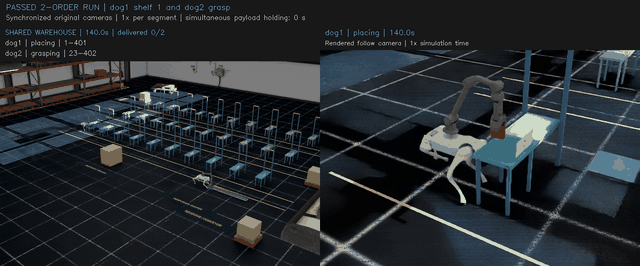
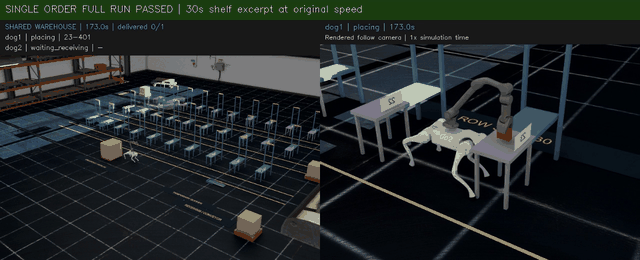
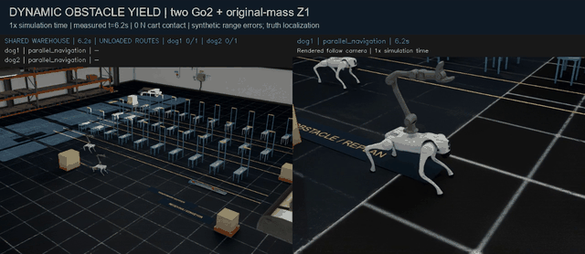

# Go2 Warehouse Logistics

**Contact-based mobile manipulation with Unitree Go2 + original-mass Z1, in Isaac Sim / PhysX.**

[中文说明](README.zh-CN.md) · [Demo gallery](docs/index.html) · [Reproduce](docs/REPRODUCING.md) · [Architecture](docs/ARCHITECTURE.md) · [Verified scope](docs/RESULTS.md)

[](docs/media/showreel_1x.mp4)

**[Watch the 52-second showreel](docs/media/showreel_1x.mp4)** — edited recorded excerpts, original speed within each segment. Each demo below also includes the complete run.

This project connects visual parcel identification, shared-resource scheduling, range-based navigation, learned leg control and force-regulated arm manipulation. The Z1 retains its approximately **5.221 kg** original mass and original motor/joint limits. Parcels remain independent dynamic bodies: no grasp bindings, runtime pose resets or rescue forces.

## Three recorded demos

| Two dogs, two deliveries | Delivery to far shelf 23 | Dynamic obstacle yield |
|:---:|:---:|:---:|
| [](docs/media/dual_delivery/demo_1x.mp4) | [](docs/media/far_shelf/demo_1x.mp4) | [](docs/media/dynamic_navigation/demo_1x.mp4) |
| Two image-identified parcels, contact grasp, shelves 1/23, both dogs home | Contact grasp, approximately 12 m measured loaded displacement, shelf release and return | Two unladen dogs yield to a moving cart with perturbed range measurements |
| [101.2 s highlights](docs/media/dual_delivery/demo_1x.mp4) · [364 s complete recording](docs/media/dual_delivery/full_run_1x.mp4) | [30 s shelf excerpt](docs/media/far_shelf/demo_1x.mp4) · [247 s complete recording](docs/media/far_shelf/full_run_1x.mp4) | [37 s synchronized cameras](docs/media/dynamic_navigation/demo_1x.mp4) · [complete overview + telemetry](docs/media/dynamic_navigation/full_run_1x.mp4) |

GIFs are eight-second excerpts at 1x simulation speed. Cuts retain their original simulation timestamps; no interpolation or synthesized footage is used.

## Measured results

| Recorded test | Physical duration | Result and final error | Evidence |
|---|---:|---|---|
| Two-order shared warehouse | 364.070 s | 2/2 delivered; placement **2.12 / 5.42 mm**; home **19.87 / 19.97 mm** | [acceptance](evidence/dual_delivery/acceptance.json) · [configuration](evidence/dual_delivery/recorded_configuration.json) |
| Far shelf 23, one active carrier | 247.155 s | 1/1 delivered; placement **5.42 mm**; active dog's home **19.65 mm** | [acceptance](evidence/far_shelf/acceptance.json) · [configuration](evidence/far_shelf/recorded_configuration.json) |
| Perturbed-range dynamic cart | 37.170 s | maximum measured cart contact **0 N**; home **24.86 / 32.07 mm** | [acceptance](evidence/dynamic_navigation/acceptance.json) · [configuration](evidence/dynamic_navigation/recorded_configuration.json) |

These are individual accepted recordings from a known warehouse and seed, **not an estimated success rate**. The dual test overlaps navigation and manipulation, but has **0 s simultaneous payload holding**. The dynamic test is **unladen**, uses a scripted kinematic cart, and adds synthetic 1 cm range noise, 5 mm quantization and 3% dropout. Localization is simulator truth; onboard SLAM is not implemented.

The final goal is a configurable multi-dog warehouse. The shared-world physical runtime currently supports **two dogs**. Continuous six-parcel delivery remains unaccepted; the latest development attempt stopped on the original 20 N jaw-force guard during placement. See [current limits and next work](docs/RESULTS.md).

## Inspect without a simulator

```bash
git clone https://github.com/Uljh/go2-warehouse-logistics.git
cd go2-warehouse-logistics
python scripts/verify_release.py
python -m http.server 8000
```

Open **http://localhost:8000/docs/** for an inline video gallery. GitHub renders the GIF previews directly; MP4 links open the recorded videos. Optional checks:

```bash
python scripts/verify_release.py --measurements
python scripts/verify_release.py --media --models
```

The first optional check independently rechecks every frame in the published compressed 200 Hz measurement projections. Media/model checks require OpenCV and PyTorch. These checks inspect saved evidence; they do not start a simulation.

## Run a physical demo

Recorded environment: **Windows, Isaac Sim 6.0.1, Isaac Lab 6.1.17, PyTorch 2.10.0+cu128, RSL-RL 5.0.1**. A CUDA-capable NVIDIA GPU and the separately installed simulator/assets are required.

```powershell
python scripts/run_demo.py dual_delivery --dry-run
python scripts/run_demo.py far_shelf --dry-run
python scripts/run_demo.py dynamic_navigation --dry-run

# After asset/environment setup in docs/REPRODUCING.md:
python scripts/run_demo.py dual_delivery --isaaclab C:/IsaacLab --isaacsim C:/isaacsim --headless
```

The launcher materializes the exact captured source profile in a new output directory. A small host adapter replaces historical absolute machine paths. Controller Python files remain byte-for-byte identical to the recorded snapshot. **The publication launcher has been checked up to the simulator boundary; a fresh checkout has not been physically rerun.**

## Code map

| Area | Entry points |
|---|---|
| Shared warehouse and scheduling | [fleet_runtime.py](go2_logistics/fleet_runtime.py), [fleet.py](go2_logistics/fleet.py), [receiving_pipeline.py](go2_logistics/receiving_pipeline.py) |
| Range mapping and navigation | [sensor_navigation.py](go2_logistics/sensor_navigation.py), [range_measurement.py](go2_logistics/range_measurement.py) |
| Perception and original Z1 | [camera_perception.py](go2_logistics/camera_perception.py), [z1_fleet_arm.py](go2_logistics/z1_fleet_arm.py), [z1_contact_control.py](go2_logistics/z1_contact_control.py) |
| Gait, support and actuation | [isaac_policy_runner.py](go2_logistics/isaac_policy_runner.py), [balance_recovery.py](go2_logistics/balance_recovery.py), [return_gait_policy.py](go2_logistics/return_gait_policy.py) |
| Recorded revisions | [repro/](repro), [source dependency provenance](repro/shared_dependency_provenance.json) |
| Learned weights and provenance | [weights/](weights), [model card](docs/MODEL_CARD.md) |
| Captured PPO adaptation implementation | [training/](training) |
| Evidence and measurement projections | [evidence/](evidence), [release verification](scripts/verify_release.py) |

Locomotion uses adapted pretrained policies; parcel detection, routing, reservations and manipulation are explicit modules. This is not an end-to-end learned warehouse policy.

## Credits and terms

Built on NVIDIA Isaac Sim / Isaac Lab, PhysX, Unitree robot descriptions, PyTorch and RSL-RL. Third-party notices are in [THIRD_PARTY.md](THIRD_PARTY.md). Simulator binaries and vendor mesh/USD assets are obtained separately under their upstream terms. No project-wide redistribution license is selected in this initial source publication; third-party licenses remain applicable to their respective materials.
