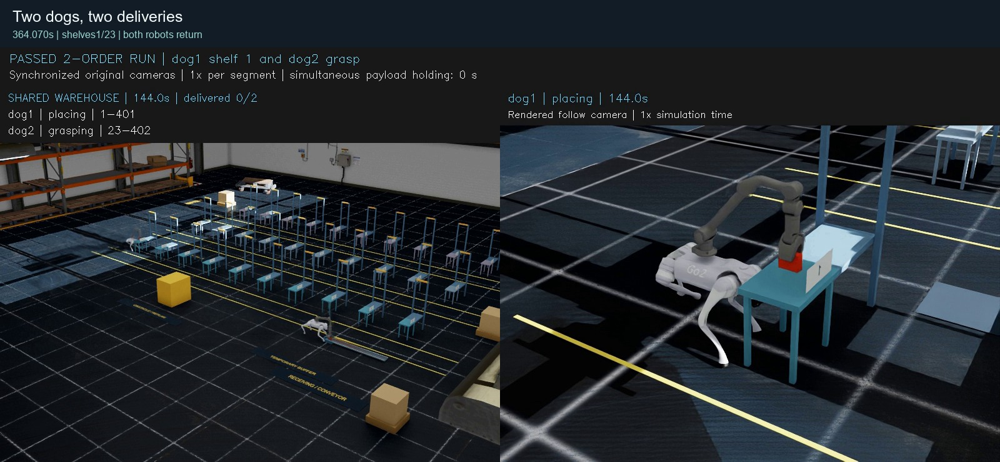

# Go2 多机器狗仓库物流

基于 **Isaac Sim / PhysX** 的移动操作项目：Go2 搭载原质量约 **5.221 kg** 的 Z1，完成视觉读码、纯接触抓取、运输、货架放置和返家。

[English](README.md) · [在线Demo画廊](https://uljh.github.io/go2-warehouse-logistics/docs/) · [运行说明](docs/REPRODUCING.md) · [架构](docs/ARCHITECTURE.md) · [成果范围](docs/RESULTS.md)

[](https://uljh.github.io/go2-warehouse-logistics/docs/media/showreel_1x.mp4)

**[52秒成果短片](https://uljh.github.io/go2-warehouse-logistics/docs/media/showreel_1x.mp4)**：真实仿真录像节选，各段内部原速播放，保留时间戳；不是一段连续任务，也不表示同时持货。

## 可以展示的三个成果

| Demo | 已完成的行为 | 原始测量 |
|---|---|---|
| [双狗双件配送](https://uljh.github.io/go2-warehouse-logistics/docs/media/dual_delivery/demo_1x.mp4) | 两狗各自读码、接触抓取，分别送1/23号架，放置、撤臂、返家 | 364.070秒；2件完成；放置误差2.12/5.42mm；返家19.87/19.97mm |
| [远端23号架单件配送](https://uljh.github.io/go2-warehouse-logistics/docs/media/far_shelf/demo_1x.mp4) | 约12m实测载货位移，纯接触放置、撤臂和返家 | 247.155秒；放置误差5.42mm；执行狗返家19.65mm |
| [带测距扰动的动态绕障](https://uljh.github.io/go2-warehouse-logistics/docs/media/dynamic_navigation/demo_1x.mp4) | 两狗空载对移动箱体退让，完成路线并返位 | 37.170秒；障碍接触最大0N；返位24.86/32.07mm |

每项包含完整原速录像、原始验收报告的公开副本、配置、源码哈希和压缩200Hz测量数据。完整录像分别为[双件](https://uljh.github.io/go2-warehouse-logistics/docs/media/dual_delivery/full_run_1x.mp4)、[远端单件](https://uljh.github.io/go2-warehouse-logistics/docs/media/far_shelf/full_run_1x.mp4)、[动态绕障](https://uljh.github.io/go2-warehouse-logistics/docs/media/dynamic_navigation/full_run_1x.mp4)。

动态绕障中有合成的1cm测距噪声、5mm量化和3%漏测；移动箱体按脚本运动，定位仍为仿真真值。它不是机载SLAM验证或载货动态避障验证。

## 技术内容

- Go2腿部策略50Hz，物理及接触控制200Hz；48维观测、12腿关节动作。
- 原Z1质量、关节限位和电机保持；夹爪通过接触力反馈控制，保留20N保护。
- 视觉识别快递编号与几何；两层PhysX射线建立局部地图，进行路径规划和动态退让。
- 同一仓库中的任务认领、取件区/通道/货架行资源预约与互斥。
- 静止和载货制动时使用受约束支撑控制，并记录逐物理步证据。
- 快递保持独立动态刚体，不使用抓取绑定、运行中写位姿或重置救援。

## 现阶段边界

最终目标是**可配置数量的多狗仓库**，当前共享世界的物理运行仍为**两狗**。双件成功中有导航与操作重叠，但同时持货为0秒，不能据此声称并行持货吞吐已经验证。

连续六件配送尚未通过；最新研发试验在放置前触发原20N夹爪保护。真实机载定位/SLAM、多批次长期稳定性、三只及以上同仓、原质量臂掉落重抓和遮挡底层取件仍需完成。三个成功录像都是已知场景的单次记录，不是随机成功率。

## 查看与运行

```powershell
git clone https://github.com/Uljh/go2-warehouse-logistics.git
cd go2-warehouse-logistics
python scripts/verify_release.py
python -m http.server 8000
```

浏览器打开 **http://localhost:8000/docs/**。GitHub首页可直接看GIF预览，点击链接看MP4。

```powershell
# 只检查真实启动脚本链，不启动仿真
python scripts/run_demo.py dual_delivery --dry-run
python scripts/run_demo.py far_shelf --dry-run
python scripts/run_demo.py dynamic_navigation --dry-run
```

实际仿真需要另行安装Isaac Sim 6.0.1 / Isaac Lab 6.1.17、准备官方资产，详见[运行说明](docs/REPRODUCING.md)。启动器按Demo恢复已录制版本，物理控制Python源码保持原哈希；仅主机路径被适配。发布入口已检查到仿真启动边界，尚未用全新克隆重新物理运行。

本次公开仓库是成果展示与必要代码整理，不改变研发默认方案，也不把失败候选提升为成功成果。
