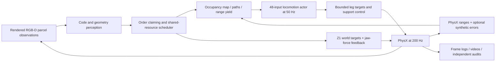

# Architecture

The project combines learned leg control with explicit perception, navigation, scheduling and manipulation modules. The physically exercised shared warehouse contains two independently controlled Go2 robots, each carrying a Z1 with its original mass and limits.

## Control responsibilities

| Module | Input and output | Boundary |
|---|---|---|
| Perception | Rendered pixels/depth to parcel code and grasp geometry | External simulator camera, not an onboard perception deployment |
| Scheduler | Order claims plus receiving/corridor/shelf-row ownership | Mutual exclusion and staged handoffs; current physical implementation is two robots |
| Navigation | Ranges/map, route goals and simulator pose to body velocity requests | Dynamic cart test adds synthetic range perturbations; pose remains truth |
| Gait | 48-dimensional state/command/history to 12 leg joint actions | Adapted pretrained actor; it does not choose parcels or arm actions |
| Manipulation | World-frame reach/release references and filtered pair contact forces to Z1 targets | Independent dynamic parcel, original Z1 mass/joints/motors, 20 N jaw guard |
| Support | Foot contacts, body attitude and motor constraints to bounded support targets | Explicit stationary/recovery authority; selecting an actor alone does not prove action authority |
| Evidence | Every physical control step plus sampled camera images | Physical completion and evidence completeness are separate verdicts |

## Revisions in this repository

The root package is based on the accepted far-shelf recording, with its required shared dependencies. `repro/` stores the differences needed to recover each recording's captured files. Each profile retains its original source manifest. Dependencies absent from the historical manifests are explicitly identified in `repro/shared_dependency_provenance.json`; their current recovered versions are not falsely called historical snapshots.

The publication launcher copies a profile into a fresh output workspace and validates all captured hashes. Only the machine-specific PowerShell host setup is adapted. Both Python controllers and the original recipe switches are preserved. This enables inspection and a documented reproduction attempt; it does not establish bitwise repeatability of GPU physics.

## Extension path

Configurable N-dog operation requires generalizing scene entity creation, per-robot state/observations, cameras, contacts and scheduler clients together. More scheduler coroutines or independent vector environments do not constitute N dogs sharing one physical warehouse. Continuous batches, three-plus robots and onboard localization remain future validation stages.
