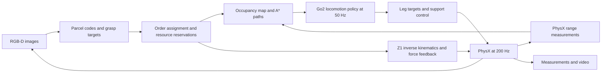

# System architecture

The system connects parcel recognition, shared scheduling, navigation and mobile manipulation. Two Go2 robots share one simulated warehouse, each carrying a Z1 arm with its original mass and motor limits.

## Modules

| Module | What it does | Code |
|---|---|---|
| Perception | Reads parcel codes and estimates grasp geometry from RGB-D images | [camera_perception.py](../go2_logistics/camera_perception.py) |
| Scheduling | Assigns orders and reserves the receiving area, corridors and shelf rows | [fleet.py](../go2_logistics/fleet.py), [receiving_pipeline.py](../go2_logistics/receiving_pipeline.py) |
| Navigation | Updates the occupancy map, plans routes and yields to obstacles | [sensor_navigation.py](../go2_logistics/sensor_navigation.py), [range_measurement.py](../go2_logistics/range_measurement.py) |
| Locomotion | Converts state and velocity commands into 12 leg-joint actions | [isaac_policy_runner.py](../go2_logistics/isaac_policy_runner.py), [return_gait_policy.py](../go2_logistics/return_gait_policy.py) |
| Manipulation | Reaches grasp/place targets and regulates gripper contact force | [z1_fleet_arm.py](../go2_logistics/z1_fleet_arm.py), [z1_contact_control.py](../go2_logistics/z1_contact_control.py) |
| Support | Stabilizes stationary and braking phases within motor constraints | [balance_recovery.py](../go2_logistics/balance_recovery.py) |
| Runtime | Steps the shared world and records robot, parcel and contact states | [fleet_runtime.py](../go2_logistics/fleet_runtime.py) |

The current perception setup uses an external rendered camera, PhysX ranges and simulator pose. The dynamic-navigation demo adds synthetic errors to the ranges. Onboard sensing and localization are planned extensions.

Leg locomotion uses a learned policy; scheduling, navigation and arm manipulation use explicit controllers. During stationary support or recovery, the support controller can take over the leg targets. See the [model card](MODEL_CARD.md) for the gait inputs and training setup.

## Demo versions

The main source package follows the far-shelf demo. The [repro/](../repro/) profiles restore the source differences and launch settings for the dual-delivery and dynamic-navigation demos.

Each profile includes its recorded source hashes. Shared dependencies recovered later are listed in [shared_dependency_provenance.json](../repro/shared_dependency_provenance.json). The launcher prepares a separate output workspace for each run and adjusts local host paths; see the [setup guide](REPRODUCING.md).

## Extending the fleet

The goal is a configurable fleet that can work independently in parallel. Moving beyond the current two-robot runtime requires generalizing scene creation, per-robot state, cameras, contacts and scheduler clients together. Longer runs, continuous batches and onboard localization are the next system-level challenges.
